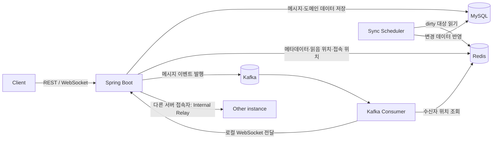

# SolChat

Spring Boot로 만든 실시간 채팅 백엔드 개인 프로젝트입니다.

채팅 기능 자체보다 **메시지를 어디에 저장할지, 서버가 여러 대일 때 수신자를 어떻게 찾을지, 조회 성능과 데이터 정합성 사이에서 어떤 선택을 할지**를 직접 구현하면서 확인해 보고 싶었습니다.

현재 회원·친구·채팅방 관리 API와 WebSocket 메시지 전송, Kafka Consumer, Redis 상태 관리 등을 구현했습니다. 이 문서에는 구현한 내용과 설계 이유를 적고, 아직 검증하지 못했거나 개선이 필요한 부분도 구분했습니다.

## 구현 범위

- **인증·사용자:** 회원가입, 로그인, JWT 인증, 친구 추가 및 목록 조회
- **채팅:** 1:1·그룹 채팅방 생성, WebSocket 메시지 송수신, 메시지·채팅방 목록 조회, 읽음 처리
- **데이터 처리:** MySQL 메시지 저장, Redis 채팅방 메타데이터·읽음 위치 관리, 스케줄러 기반 Write-behind
- **서버 간 전달:** Kafka 메시지 발행·소비, Redis 접속 위치 조회, Internal Relay API
- **트래픽 제어:** Bucket4j + Redis를 이용한 요청별 Token Bucket Rate Limit

기술 스택: Java 17, Spring Boot 3, Spring Data JPA, Spring Security, MySQL 8, Redis, Kafka, WebSocket, Docker Compose, k6

## 전체 구조



MySQL은 메시지 원본과 사용자·채팅방 등 도메인 데이터의 저장소로 사용했습니다. Redis에는 접속 위치와 채팅방 목록에 필요한 최신 상태를 두고, Kafka로 메시지 저장과 실시간 전달 처리를 분리했습니다.

이 구성은 **여러 인스턴스를 고려한 구현**입니다. 실제 다중 인스턴스 장애·부하 환경에서 확장성을 검증했다는 의미는 아닙니다.

## 설계하면서 고민한 부분

### 1. 메시지를 먼저 저장하는 이유

메시지를 WebSocket으로 먼저 전송하면, 이후 저장 과정에서 오류가 발생했을 때 화면에는 보였던 메시지가 DB에 남지 않을 수 있습니다. SolChat에서는 메시지 원본을 우선 보존하는 쪽을 선택했습니다.

현재 `ChatMessageService.processAndPublish()`의 순서는 다음과 같습니다.

1. `TransactionTemplate` 안에서 MySQL에 메시지를 저장하고 **DB 트랜잭션을 커밋**합니다.
2. Redis Lua 스크립트로 채팅방의 마지막 메시지 메타데이터를 갱신합니다.
3. Kafka에 `roomId`를 key로 메시지 이벤트를 발행하도록 `send()`를 호출합니다.
4. Consumer가 메시지를 받아 수신자의 WebSocket 세션 또는 Internal Relay로 전달합니다.

DB를 먼저 커밋하므로 이후 전달 단계가 실패하더라도 메시지 원본은 남습니다. 대신 **DB 커밋과 Redis 갱신, Kafka 발행은 하나의 원자적 작업이 아닙니다.** Redis에서 오류가 나면 Kafka 발행까지 진행하지 못할 수 있고, Kafka 비동기 발행이 실패해도 현재 애플리케이션에는 이를 복구하는 로직이 없습니다. (개선 예정)

또한 `kafkaTemplate.send()` 직후 남기는 로그는 브로커의 수신 확인(ACK)이 아니라 **발행 호출 완료**를 의미합니다. 발행 성공·실패 처리, Transactional Outbox, Consumer의 중복 처리 방지는 개선 과제로 남겨두었습니다.

관련 코드: [`ChatMessageService`](src/main/java/com/sol/solchat/service/ChatMessageService.java)

### 2. 같은 두 사용자의 채팅방이 여러 개 만들어지지 않도록

1:1 채팅방은 누가 먼저 생성 요청을 보내든 같은 방을 찾아야 합니다. 그래서 사용자 ID 두 개를 작은 값부터 정렬해 `chat_key`를 만들고, DB에 `UNIQUE` 제약을 두었습니다.

애플리케이션에서는 먼저 기존 방을 조회합니다. 동시에 생성 요청이 들어와 DB 제약 위반이 발생하면 기존 방을 다시 조회하도록 예외 처리 경로도 작성했습니다.

다만 **동시에 두 요청이 충돌하는 상황에 대한 회귀 테스트는 아직 없습니다.** JPA의 INSERT가 트랜잭션 커밋 시점에 실행되면 현재 서비스 메서드 내부의 예외 처리 구문을 거치지 않을 수 있어, 실제 동시성 테스트와 예외 처리 보완이 필요합니다.

관련 코드: [`ChatRoomService`](src/main/java/com/sol/solchat/service/ChatRoomService.java), [`ChatController`](src/main/java/com/sol/solchat/controller/ChatController.java)

### 3. 마지막 메시지와 읽음 상태를 매번 DB에 기록하지 않도록

메시지 하나를 보낼 때마다 `chat_room`의 마지막 메시지를 갱신하고, 읽음 요청마다 `chat_participant`를 즉시 갱신하면 실시간 요청 경로에 DB 쓰기가 계속 추가됩니다.

이를 줄이기 위해 채팅방의 `lastMessage`, `lastSentAt`, `lastMessageId`와 사용자별 읽음 위치를 우선 Redis에 반영합니다. 변경된 방 ID는 dirty set에 기록하고, 스케줄러가 대상 방을 모아 DB에 반영합니다. 채팅방 목록에서는 Redis의 최신 메타데이터를 우선 사용합니다.

메타데이터 갱신에는 Lua 스크립트를 사용했습니다. 마지막 메시지 ID를 비교한 뒤 Hash 갱신과 dirty set 추가를 한 번에 실행해, 이전 메시지가 나중에 도착해 최신 메타데이터를 덮어쓰는 일을 줄이려는 목적입니다.

- 채팅방 메타데이터: `chatroom:metadata:{roomId}`
- 읽음 위치: `room:read_pos:{roomId}` (Hash field: `userId`)
- 읽음 위치 변경 대상: `room:read_pos:dirty`

이 방식의 대가는 **Redis와 DB 사이의 일시적 불일치**입니다. 일부 DB 동기화 실패 시 dirty 대상을 재등록하는 처리는 있지만, 스케줄러 중단이나 처리 중 장애에 대한 완전한 복구 보장은 아직 없습니다. Redis Streams 또는 ACK 가능한 큐 기반 동기화는 후속 개선 후보입니다.

### 4. 채팅방 목록에서 반복 조회 줄이기

채팅방 목록을 조회할 때 방마다 참여자와 상대 사용자 정보를 개별 조회하면 N+1 쿼리가 발생할 수 있습니다.

이를 줄이기 위해 채팅방 ID를 먼저 모아 참여자를 `IN` 조회하고, 1:1 채팅 상대의 사용자 정보도 일괄 조회한 뒤 `Map`으로 응답을 조립했습니다.

다만 **미읽음 개수는 현재 방마다 COUNT 쿼리를 실행합니다.** 참여자·상대 사용자 조회는 묶었지만 모든 조회 병목을 제거한 것은 아닙니다. 방별 COUNT는 다음 최적화 대상입니다.

### 5. 다른 서버에 접속한 사용자에게 메시지 전달하기

WebSocket 세션은 연결을 받은 서버의 메모리에 있습니다. 수신자의 세션이 현재 서버에 없다면 Redis에서 `userId → serverId` 매핑을 조회하고, 대상 서버의 Internal Relay API로 전달하도록 구성했습니다.

이 경로는 코드로 구현했지만 실제 다중 인스턴스 E2E 테스트는 별도로 수행하지 않았습니다. 현재 Relay 실패 시 로그만 남기며 재시도·서킷브레이커는 구현하지 않았습니다. 사용자당 단일 서버 매핑 방식은 멀티 디바이스 접속에도 한계가 있습니다.

### 6. 인증과 요청 제한

WebSocket 연결 시 JWT를 검증해 서버 세션에 `userId`를 저장하고, 메시지 처리 시 클라이언트가 보낸 `sender` 대신 검증된 사용자 ID를 사용합니다. 메시지 전송 전 채팅방 참여 여부도 확인합니다.

또한 Bucket4j와 Redis를 이용해 요청별 Token Bucket을 적용했습니다. 회원가입·로그인 등 인증 전 요청은 IP 기준, 인증 후 채팅방 생성·메시지 전송 등은 사용자 ID 기준으로 제한합니다.

## 테스트 및 측정

### 작성된 테스트와 아직 부족한 검증

프로젝트에 회원가입·로그인, 친구 추가, Rate Limit, Redis Lua 메타데이터 갱신, 스케줄러 동기화 등 일부 테스트 코드가 있습니다. 테스트 **코드가 존재하는 것**과 모든 통합 시나리오가 **검증을 통과한 것**은 구분하고 있습니다.

추가로 필요한 테스트는 다음과 같습니다.

- 동일한 사용자 조합의 1:1 채팅방 동시 생성과 UNIQUE 충돌 처리
- MySQL 저장 성공 후 Redis·Kafka 실패 주입
- WebSocket → Kafka → Consumer → WebSocket 통합 흐름
- Internal Relay 및 장애 상황에서의 전달 결과

### k6 측정 결과

로컬 Docker 환경에서 측정한 결과입니다. 운영 환경의 처리량이나 지연 시간을 보장하는 수치는 아닙니다.

| 시나리오 | 조건 | 결과 |
| --- | --- | --- |
| 채팅방 목록 API | Read API 혼합 부하 약 100 RPS, 3분 | p95 약 **67ms** |
| 메시지 목록 API | 동일 테스트 | p95 약 **10ms** |
| WebSocket 1:1 메시지 전달 | sender 50 + receiver 50 세션, 1분 전송 | 송신자 timestamp 기준 E2E p95 약 **243ms** |

REST Read API 측정에서는 HTTP error 0%를 기록했습니다. 이 결과는 정상 흐름의 응답 지연 측정이며, Kafka 장애 복구나 다중 서버 Relay의 정상 동작을 증명하지는 않습니다.

테스트 스크립트와 결과 파일은 [`solchat_perf_assets/`](solchat_perf_assets/)에서 확인할 수 있습니다.

## 남아 있는 문제

| 영역 | 현재 한계 | 다음에 확인하거나 개선할 내용 |
| --- | --- | --- |
| 메시지 정합성 | DB 커밋 후 Redis·Kafka에서 실패하면 실시간 전달 누락 가능 | 장애 주입 테스트, 발행 결과 처리, Outbox 검토 |
| Kafka 재처리 | Consumer 중복 전달 방지 미구현 | `messageId` 기반 멱등 처리 |
| 1:1 방 동시 생성 | 커밋 시점 UNIQUE 충돌 응답 미검증 | 동시성 통합 테스트 및 예외 처리 보완 |
| Write-behind | 일부 실패 경로에서 dirty 대상 유실 가능 | ACK 기반 동기화·복구 전략 검토 |
| Internal Relay | 서버 간 전달 E2E·실패 재시도 미검증 | 다중 서버 테스트, 재시도 정책 |
| 채팅방 조회 | 방별 unread COUNT 쿼리 | 집계 테이블 또는 카운터 방식 비교 |
| 멀티 디바이스 | `userId → serverId` 단일 위치 매핑 | 세션 단위 매핑 설계 |

## 실행 방법

### 준비

- Java 17
- Docker / Docker Compose

저장소의 `.env.example`을 복사하고 로컬 설정을 입력합니다.

```bash
cp .env.example .env
```

`.env`에 `DB_USERNAME`, `DB_PASSWORD`, `DB_ROOT_PASSWORD`, `JWT_SECRET`, `INTERNAL_SECRET` 등을 설정합니다. **`.env`나 테스트용 JWT 파일은 저장소에 커밋하지 않습니다.**

### 로컬 실행

```bash
# MySQL / Redis / Kafka / Kafka UI
docker compose up -d

# Spring Boot 애플리케이션
./mvnw spring-boot:run
```

Kafka UI: <http://localhost:8090>

### 주요 API

| 기능 | 메서드 | 경로 |
| --- | --- | --- |
| 회원가입 | POST | `/api/auth/join` |
| 로그인 | POST | `/api/auth/login` |
| 1:1 채팅방 생성 | POST | `/api/chat/room` |
| 그룹 채팅방 생성 | POST | `/api/chat/group` |
| 채팅방 목록 | GET | `/api/chat/rooms` |
| 메시지 목록 | GET | `/api/chat/rooms/{roomId}/messages` |
| 읽음 처리 | POST | `/api/chat/rooms/{roomId}/read` |
| 세션 Heartbeat | POST | `/api/chat/heartbeat` |
| 친구 목록 / 추가 | GET / POST | `/api/friends` |

WebSocket 연결: `ws://localhost:8080/ws/chat?token=<JWT>`

```json
{
  "type": "CHAT",
  "roomId": "2",
  "sender": "",
  "content": "hello"
}
```

`sender` 값은 서버에서 WebSocket 세션의 인증된 사용자 ID로 대체합니다.

### k6 테스트 실행

테스트 데이터와 토큰을 준비한 뒤 아래 스크립트를 실행할 수 있습니다. 자세한 시드 파일과 실행 조건은 `solchat_perf_assets/`를 참고합니다.

```bash
# 채팅방·메시지 목록 Read API
k6 run --summary-export summary_50.json \
  -e BASE_URL=http://localhost:8080 \
  -e TOKEN="$TOKEN" \
  -e RATE=100 \
  -e DURATION=3m \
  solchat_perf_assets/rooms/k6_rooms_messages.js
```

WebSocket E2E 테스트는 `solchat_perf_assets/ws/`의 사용자 쌍 생성 스크립트와 k6 스크립트를 사용합니다. 테스트용 계정과 토큰 정보를 준비한 뒤 실행합니다.

```bash
cd solchat_perf_assets/ws
python3 generate_1on1_pairs.py

k6 run --summary-export ws_summary_1on1.json \
  -e WS_BASE_URL=ws://localhost:8080 \
  -e RECEIVER_VUS=50 \
  -e SENDER_VUS=50 \
  -e SEND_DURATION=1m \
  -e WARMUP=5s \
  -e COOLDOWN=10s \
  -e MSGS_PER_SEC=2 \
  k6_ws_chat_e2e_aligned.js
```

⚠️ ws_pairs.json에는 테스트 계정의 JWT 토큰이 포함되므로 Git에 커밋하지 않습니다.
